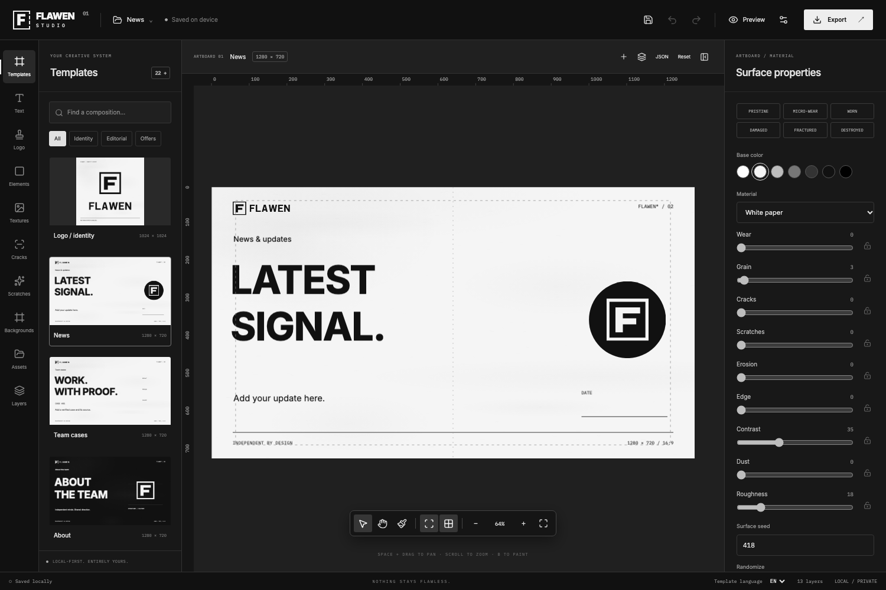
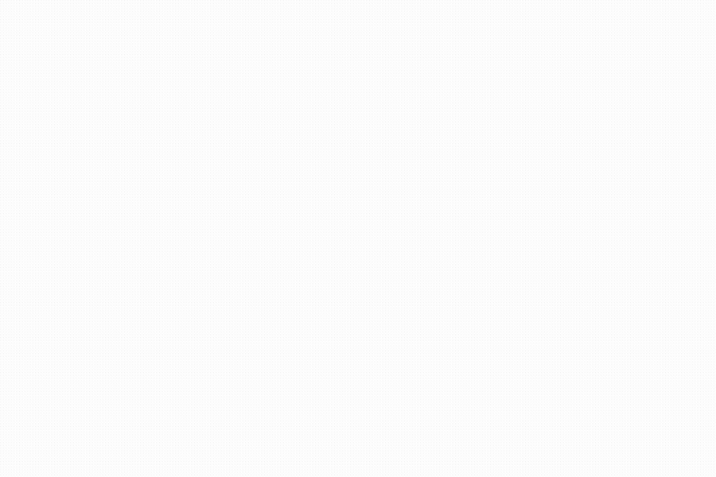
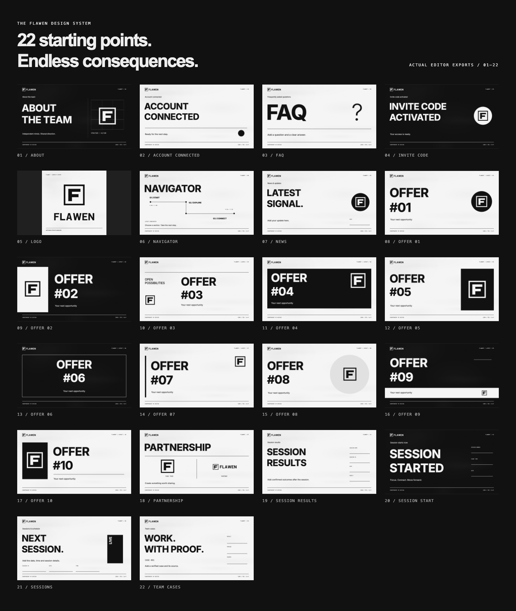

<div align="center">

# FLAWEN STUDIO

**PRECISION IS THE STARTING POINT. IMPERFECTION IS YOUR TOOL.**

A local-first graphics editor for the FLAWEN design system.<br>
Build the composition. Wear down the surface. Keep control of every layer.

[](https://github.com/nullptrowner/flawen-studio/actions/workflows/ci.yml)


[Start locally](#start-locally) · [Templates](#the-template-collection) · [Export](#export) · [Deployment](#deployment) · [Technical notes](#technical-notes)



**NOTHING STAYS FLAWLESS.**

</div>

## One identity. An editable system.

Every template opens as editable text, vector logos, shapes, lines and procedural damage. Move the logo, replace a headline, change the surface, paint a fracture and export the result.

| Compose                           | Shape the material                  | Deliver                         |
| :-------------------------------- | :---------------------------------- | :------------------------------ |
| 22 built-in compositions          | Six material families               | PNG, WebP and SVG               |
| Russian and English defaults      | Eight seeded crack generators       | Exact output dimensions         |
| Multiline typography              | Seven reversible brush modes        | Fit, crop or layout reflow      |
| Layers, groups and transforms     | Independent grain, dust and erosion | Numbered offers and ZIP batches |
| Editable vector identity          | Parameter locks and stored seeds    | Portable project JSON           |
| Custom templates and logo presets | Undo and redo                       | IndexedDB autosave              |

## The surface remembers

Choose paper, plaster, porcelain or distressed print. Control nine independent material properties. Paint damage, remove it while preserving the material, or restore a completely clean surface. Brush strokes remain editable operations in the project.



[Watch the full recording](docs/media/material-demo.webm)

Screenshots and recordings come from the running application. The template gallery contains actual exported PNGs.

## The template collection



| Collection | Included compositions                                                         |
| :--------- | :---------------------------------------------------------------------------- |
| Identity   | Logo; avatar, square and horizontal formats through project settings          |
| Editorial  | News · Team cases · About · FAQ · Sessions · Partnership · Navigator          |
| Operations | Invite code activated · Account connected · Session results · Session started |
| Offers     | OFFER #01—#10: ten separately selectable layouts                              |

Choose EN or RU before applying a template. User-entered text is never translated automatically. Metrics and results start empty: the editor does not invent performance data.

The logo is an **original SVG interpretation** of the geometric F / fractured frame brief. The original concept image was unavailable; this is not an exact reproduction. Upload your own SVG or PNG master when needed.

## Start locally

Use **Node.js 24 LTS** and npm.

```sh
npm ci
npm run dev
```

Open **http://127.0.0.1:5180**. No environment variables, API keys, account, backend or external design service are required. Fonts are bundled locally.

### Your first artwork

1. Select **News** in Templates.
2. Select its headline in Layers and edit **Text content**, or double-click the text on canvas.
3. Select the surface and choose a material and wear state.
4. Insert two fractures from Cracks. Adjust their independent seeds and geometry.
5. Move, resize or distress the logo.
6. Save; wait for the saved status.
7. Export a **1280 × 720 PNG**.

Drag objects and transformation handles on canvas. Shift-click for multiple selection. Drag top-level layers to reorder, group selections and toggle visibility or locks. Guides and safe areas never enter exports.

| Shortcut                | Action                            |
| :---------------------- | :-------------------------------- |
| Cmd / Ctrl + Z          | Undo                              |
| Cmd / Ctrl + Shift + Z  | Redo                              |
| Cmd / Ctrl + C / V      | Copy / paste layers inside Studio |
| Cmd / Ctrl + D          | Duplicate                         |
| Cmd / Ctrl + G          | Group                             |
| Cmd / Ctrl + Shift + G  | Ungroup                           |
| Delete / Backspace      | Remove selected unlocked layers   |
| Arrows / Shift + arrows | Nudge / larger nudge              |
| Space + drag            | Pan                               |
| Mouse wheel             | Zoom                              |
| B                       | Damage brush                      |

Typing in inputs or editing canvas text retains normal keyboard behavior.

## Export

**PNG** is lossless. **WebP** exposes quality control. **SVG** embeds bundled fonts, vector artwork and raster assets. **JSON** retains the complete editable scene, assets and seeds.

Choose common social sizes or custom dimensions. Fit preserves the composition with letterboxing; crop fills the target; reflow adjusts positions and typography without stretching logos. Review substantially changed aspect ratios. Transparent export explicitly removes the material and painted damage, leaving foreground layers.

Batch generation supports sequential numbering, shared subtitles, a shared logo, independently seeded material and CSV/JSON text replacement. Download up to 30 artworks as one ZIP.

```csv
title,subtitle
OFFER #01,Your verified offer details
OFFER #02,Your second announcement
```

```json
[
  { "title": "OFFER #01", "subtitle": "Your verified offer details" },
  { "title": "OFFER #02", "subtitle": "Your second announcement" }
]
```

## Your projects stay yours

Projects, assets, templates and saved styles live in **IndexedDB**. Autosave runs after an editing pause, and the last project is restored on launch. Switching templates saves the current project first. Manual save, duplicate, rename, delete and JSON import/export are available.

Storage belongs to the current browser profile and origin. Clearing site data removes it. **Export JSON backups for important work**, especially before moving domains or browsers. Undo history is session-local; the scene, strokes and seeds persist.

## Deployment

This is a standalone React application, including when checked out inside the main FLAWEN repository's `design/` directory.

```sh
npm ci
npm run build
npm run preview
```

Publish **`dist/`** on a static HTTPS host. Build command: `npm run build`. **No build environment variables are required.** Node.js 24 LTS is recommended. For subdirectory hosting, configure Vite's `base` before building; the default serves a domain root.

Production needs no server process. `preview` inspects the production build locally. Use HTTPS or localhost for browser secure-context APIs. There is no application authentication; configure hosting access control if the editor URL must be private.

## Technical notes

| Boundary               | Responsibility                                     |
| :--------------------- | :------------------------------------------------- |
| `src/types/project.ts` | Versioned runtime schema and scene model           |
| `src/editor/store.ts`  | Commands, selection, history                       |
| `src/editor/canvas/`   | Fabric interactions and shared rendering           |
| `src/editor/groups.ts` | Affine group / ungroup geometry                    |
| `src/editor/panels/`   | Library, inspector, project workflows              |
| `src/editor/export/`   | Output sizing, font embedding, batch ZIP           |
| `src/effects/`         | Deterministic surface, cracks and brush operations |
| `src/branding/`        | Vector logo variants                               |
| `src/templates/`       | Data-driven presets and batch generation           |
| `src/persistence/`     | IndexedDB, portable projects, saved library assets |
| `src/utils/assets.ts`  | SVG sanitation and grayscale raster import         |

React renders the UI; Fabric handles imperative canvas interaction. Zustand owns the scene. Preview and export share their renderer. Zod validates imported projects. Procedural geometry and caches are bounded; pointer movement does not write React state every frame.

### Practical limits

- Artboards: 64–4096 px per side. Export: up to 8192 px per side and 32 megapixels.
- Up to 200 layers, eight group levels, 50 embedded assets and 30 undo snapshots.
- Uploads: 8 MB source, bounded normalized data, 8192 px / 24 megapixels maximum.
- Project imports: 24 MB; embedded asset data has a 20-million-character budget.
- Up to 250 strokes / 30,000 stored points; long strokes are resampled for bounded rendering.
- SVG imports support a safe subset. Scripts, external resources, HTML and `use` references are rejected; flatten unsupported constructions before upload.
- Space Grotesk lacks Cyrillic; Cyrillic explicitly uses Inter, with an inspector notice. Inter, Roboto Flex and IBM Plex Mono support Cyrillic.
- Shape clipping uses rectangular bounds. Ungroup before reordering nested layers.
- Procedural SVG layers are embedded SVG images, not a flattened path tree. Third-party SVG editors may render embedded fonts or nested SVG differently. Use PNG for fixed output and JSON for continued editing.
- Desktop is the primary workspace. Mobile offers collapsible panels and touch controls.
- Vite reports a bundle chunk above its 500 kB advisory threshold. No cross-browser performance or 60 FPS guarantee is claimed.

## Verification

```sh
npm run check
npx playwright install chromium
npm run test:e2e
```

The checks run strict types, unit tests and a production build. Browser tests cover News editing, Cyrillic, cracks, brush operations, save/reload, grouping fidelity, guide exclusion, safe SVG uploads, portable JSON pixel equality, all 22 PNGs, ZIP batches, transparent PNG, WebP/SVG dimensions and mobile panels.

Refresh documentation from the real editor:

```sh
npm run dev
# In another terminal:
npm run test:e2e
node scripts/capture-docs.mjs
```

The capture script records material states and builds the gallery from exported artwork. FFmpeg regenerates the README GIF; it is not needed to run Studio.

---

<div align="center">

**FLAWEN STUDIO**<br>
Monochrome precision. Controlled imperfection.<br>
<sub>NOTHING STAYS FLAWLESS.</sub>

</div>
